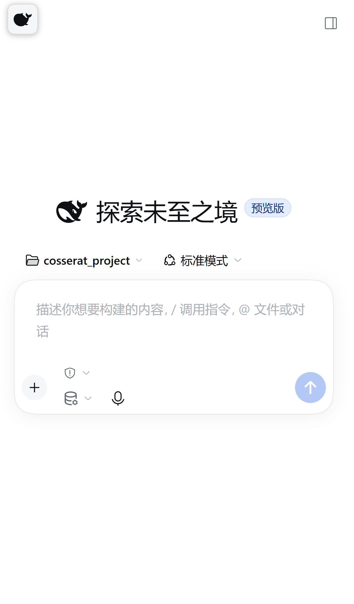

# DSH Phone Remote

> 把 [DeepSeek Harness](https://deepseek.com) 装进手机：iPhone 主屏一个全屏 App，随时查看和指挥电脑上正在跑的 AI Agent / 长跑计算任务。
>
> 手机和电脑是**同一个会话**：手机发的指令电脑执行，电脑的进度手机实时看。

本项目是对第三方开源插件 [`@linxin666/dsh-remote-web-ui`](https://github.com/zhu1090093659/dsh-web)（Apache-2.0）的一套**开箱即用封装 + iOS 修复 + 7×24 常驻脚本**，一次性解决三个实际痛点：

| 痛点 | 本仓库的解法 |
|---|---|
| iOS「添加到主屏幕」后点开停在 `401 authentication required` | `dsh-phone-home` 插件接管 `manifest.webmanifest`，把 `start_url` 指到 `/pair-app`，**不再依赖 Service Worker** |
| 想“电脑开着就随时能用” | 登录自启 + 托盘常驻 + 每 1 分钟守护自愈 + 关闭睡眠/休眠 |
| 不想每天扫码 | 固定域名 + 设备 Cookie，**配对一次长期有效**；电脑重启/更新也不用重配 |

> 仓库地址：<https://github.com/David060323/dsh-phone-remote>

## 效果



- 手机点主屏图标 → 直接进入 DSH 官方界面（全屏、无地址栏、竖屏触控优化）
- 手机与电脑端同一个会话，双向实时同步
- 电脑重启 / App 更新 / 隧道断线重连：域名不变、免重新配对

## 架构

```
┌────────────── 手机 (iPhone) ──────────────┐
│ 主屏 App (PWA, 官方 Web GUI, 全屏)         │
│   start_url = /pair-app  ← 本仓库修复      │
└───────────────────┬────────────────────────┘
                    │ HTTPS（固定域名）
┌───────────────────▼────────────────────────┐
│ Cloudflare 快速隧道 → 固定域名中继          │
│   https://<id>.dsh-market.com              │
├────────────────────────────────────────────┤
│ DSH 宿主（桌面版 或 `dsh web`）             │
│  └ @linxin666/dsh-remote-web-ui            │
│      · 设备配对 / 门控 /remote 通道          │
│      · /pair-app 只凭设备 cookie 放行        │
│  └ dsh-phone-home（本仓库）                 │
│      · 覆盖 /manifest.webmanifest            │
│      · 主屏图标资源                          │
└────────────────────────────────────────────┘
```

## 快速开始

### 前置条件

- Windows 10/11（脚本按 Windows 编写；插件本身跨平台）
- DeepSeek Harness：桌面版或命令行 `dsh web`，均需 ≥ 0.2.1-rc.2（与 `dsh-remote-web-ui 0.4.7` 的要求一致）
- 网络能连通 Cloudflare（快速隧道默认走 Cloudflare；被墙可用自己的命名隧道）
- 手机：iPhone（Safari 支持 PWA / Service Worker），Android 类似

### 方案 A：`dsh web` 独立常驻（最省心，推荐 24h 在线）

```powershell
# 1) 安装远程访问插件（官方 CLI）
dsh plugin --profile web add @linxin666/dsh-remote-web-ui@latest

# 2) 安装本仓库的 iOS 修复插件
dsh plugin --profile web add link:<本仓库路径>\dsh-phone-home

# 3) 编辑 %USERPROFILE%\.dsh\profiles\web\cordis.patch.yml，追加：
#    - id: remote-web-ui
#      name: "@linxin666/dsh-remote-web-ui"
#      config:
#        autoTunnel: true          # 自动 Cloudflare 快速隧道
#        relay: true               # 固定域名中继（重启不变域名）
#        idleExpireMs: 315360000000
#        maxDevices: 8

# 4) 启动
dsh web
```

电脑 GUI 侧栏底部出现**手机图标** → 点开 → 二维码 → **iPhone 用「相机」扫码**（不要用微信扫一扫）→ 自动配对进入界面 → Safari 分享 → 添加到主屏幕。

再用 `scripts/register-web-guardian.ps1` 注册登录自启 + 崩溃自愈的计划任务。

### 方案 B：桌面版（手机 = 桌面版当前会话）

> 桌面版 profile 由 Electron 管理，不能用 `dsh plugin` CLI 直接装；以下步骤需要能调用 `plugin_manager` 的 Agent 协助（或手动编辑 profile）。

1. 把 `@linxin666/dsh-remote-web-ui` 和本仓库 `dsh-phone-home` 装进 profile `desktop`（bundle 列表里追加，`dependencies` 用 `link:`）；
2. 在 `~/.dsh/profiles/desktop/cordis.patch.yml` 追加与方案 A 相同的配置块；
3. 用 `scripts/register-desktop-watchdog.ps1` 注册桌面版守护任务（登录自启 + 1 分钟自愈）；
4. 配对流程同上。

这样手机看到的就是电脑上**正在用的那个会话**，而不是另一个 DSH 实例。

### 常驻与可用性（Windows）

- `scripts/keep-desktop-alive.ps1` / `.vbs`：隐藏窗口检查桌面版进程，缺失则拉起
- `scripts/register-desktop-watchdog.ps1`：注册计划任务（登录触发 + 每 1 分钟）
- `scripts/keep-web-alive.ps1` + `register-web-guardian.ps1`：`dsh web` 守护循环
- 系统设置：关闭睡眠/休眠（`powercfg /change standby-timeout-ac 0`），合盖行为按需
- 需要“重启后无人值守可用”时开启 Windows 自动登录（自行评估物理安全）

### 手机端安装（一次）

1. 电脑面板铸造二维码（10 分钟有效）
2. **iPhone 自带「相机」扫码** → Safari 打开 → 配对成功进入界面
3. Safari → 分享 → **添加到主屏幕**
4. 以后点图标直达；电脑重启/App 更新后**免重新配对**

## iOS 主屏 401 的原因与修复

iOS 主屏 Web App 按页面所链 manifest 的 `start_url` 启动。官方 manifest 的 `start_url` 是 `"./"`（= 根地址 `/`），而根地址由 harness 兜底、需要 harness 的 browser-auth cookie → 401。

`dsh-phone-home` 把 manifest 的 `start_url` 改成 `/pair-app`。`/pair-app` 只凭设备 cookie 就放行（实测：**禁用 Service Worker 也返回 200 并正常渲染**），因此主屏 App 不再依赖“重开 Service Worker 接管 `/` 导航”这条路径。

装好修复后**必须删掉旧主屏图标、重新添加一次**（旧图标用的是旧 manifest 的 start_url）。

## 常见坑

| 现象 | 原因 / 解法 |
|---|---|
| 微信里打开显示 401 | 微信/App 内置浏览器不支持 Service Worker；用**相机**扫码或把链接复制到 Safari |
| 主屏图标打开 401 | 旧 manifest；安装 `dsh-phone-home` 后删除图标重装 |
| 应急入口 | `https://<你的域名>/pair-app`：无 Service Worker 也能进（已配对设备） |
| `cloudflared` 下载失败（GitHub `ETIMEDOUT`，国内常见） | 用 `pnpm add cloudflared`（已带二进制缓存）或把其它 profile 里现成的 `bin/cloudflared.exe` 拷到目标 profile 的 `node_modules/cloudflared/bin/` |
| 隧道 `Error 1033` | Cloudflare 快速隧道边缘掉线；插件会看门狗重连，域名不变，等 1~2 分钟 |
| 页面显示实例离线 | 电脑关机或宿主没跑；开机后约 30 秒自动恢复，免重配 |

更多见 [`docs/TROUBLESHOOTING.md`](docs/TROUBLESHOOTING.md)。

## 安全模型（务必读）

- **配对设备 = 这台电脑的完整控制凭据**：可聊天、读写文件、执行命令。只配对你自己的手机。
- 固定域名中继的流量经过 `@linxin666/dsh-remote-web-ui` 作者运营的 Cloudflare Worker；配对校验与应用层检查留在本机。想完全避开：关 `relay`（域名每次重启会变），或使用自带域名的命名隧道。
- 配对链接本身就是凭据：别外传；可在面板「停止/撤销设备」。
- 远程访问面板默认只监听回环，控制端点只在回环应答。

## 文件说明

```
dsh-phone-home/           iOS 主屏修复插件（manifest start_url + 图标）
scripts/                  常驻/守护脚本（Windows PowerShell）
docs/ARCHITECTURE.md      架构与实现细节
docs/TROUBLESHOOTING.md   排错手册
publish/                  发文章/挂闲鱼/出处用的现成文案
screenshots/              手机端效果截图
```

## License 与致谢

- 本仓库代码：[MIT](LICENSE)
- 远程访问能力依赖 [`@linxin666/dsh-remote-web-ui`](https://github.com/zhu1090093659/dsh-web)（Apache-2.0），版权归其作者。本仓库在 DSH `0.2.1-rc.2` + `dsh-remote-web-ui 0.4.7` 上实测通过。
- DeepSeek Harness 归 DeepSeek 所有；本项目与 DeepSeek 官方无关
